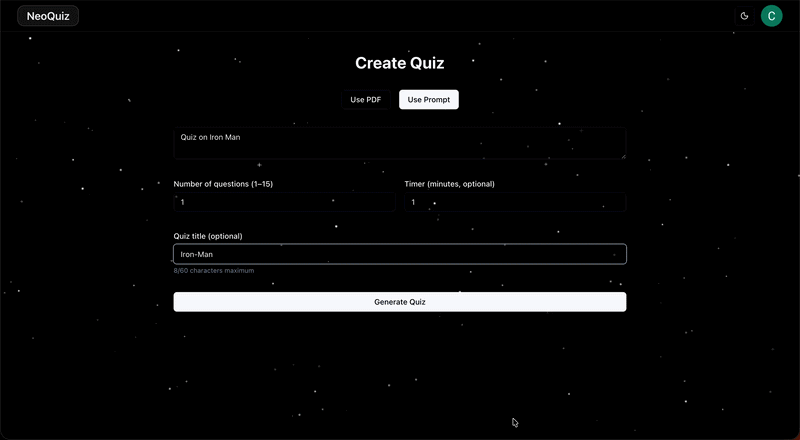
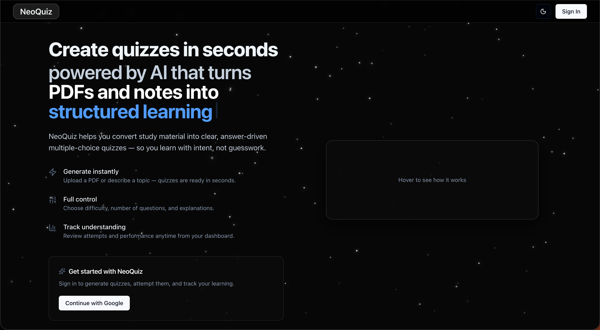
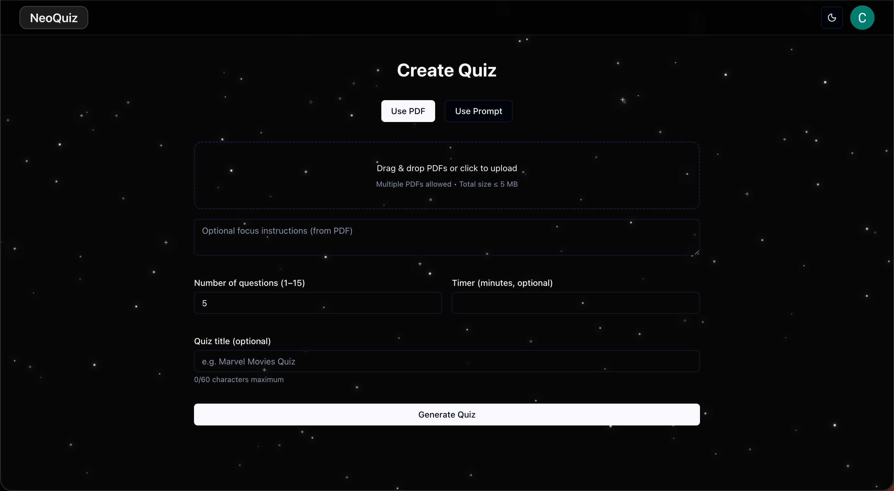
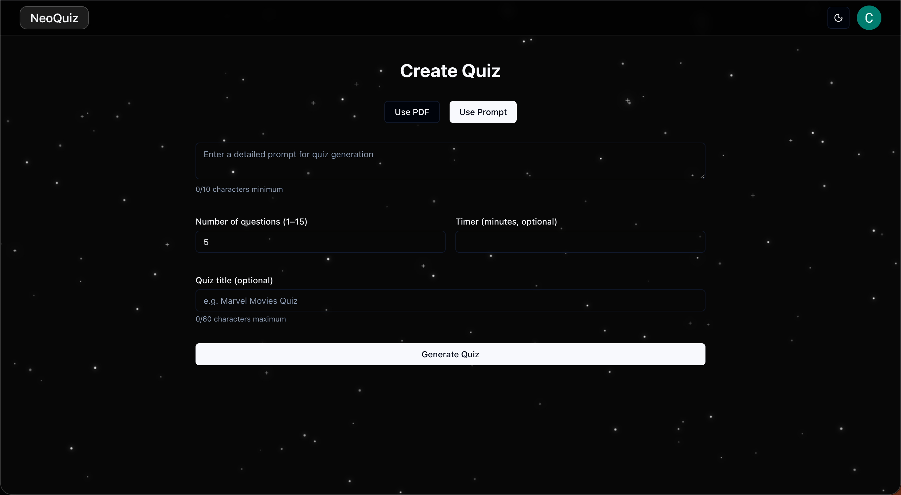
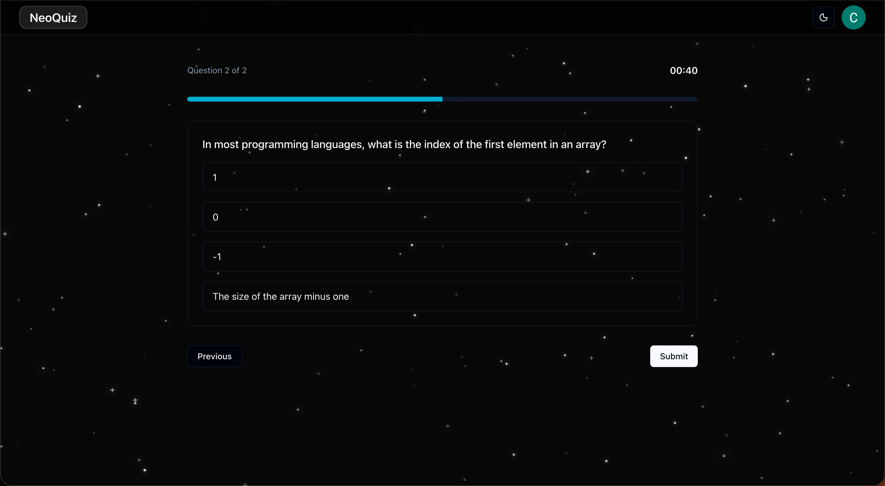
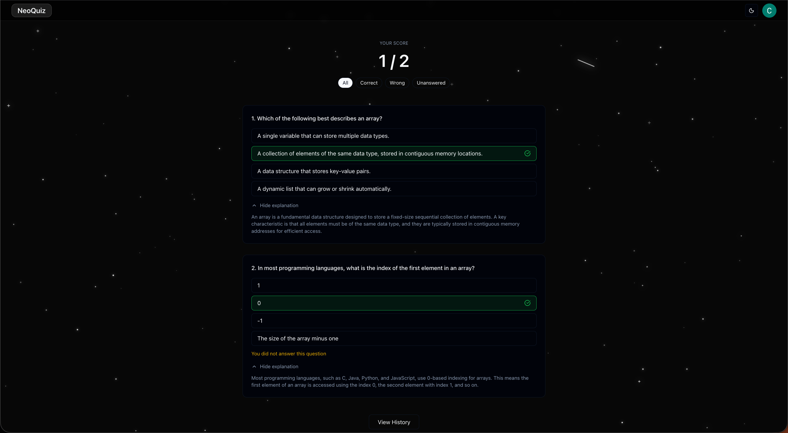
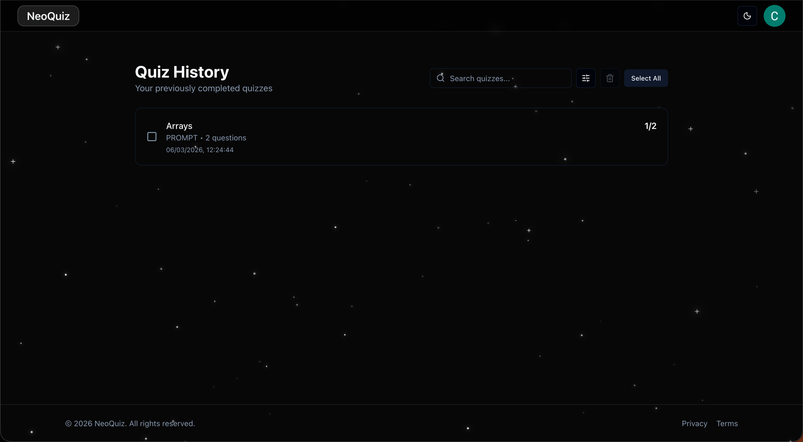
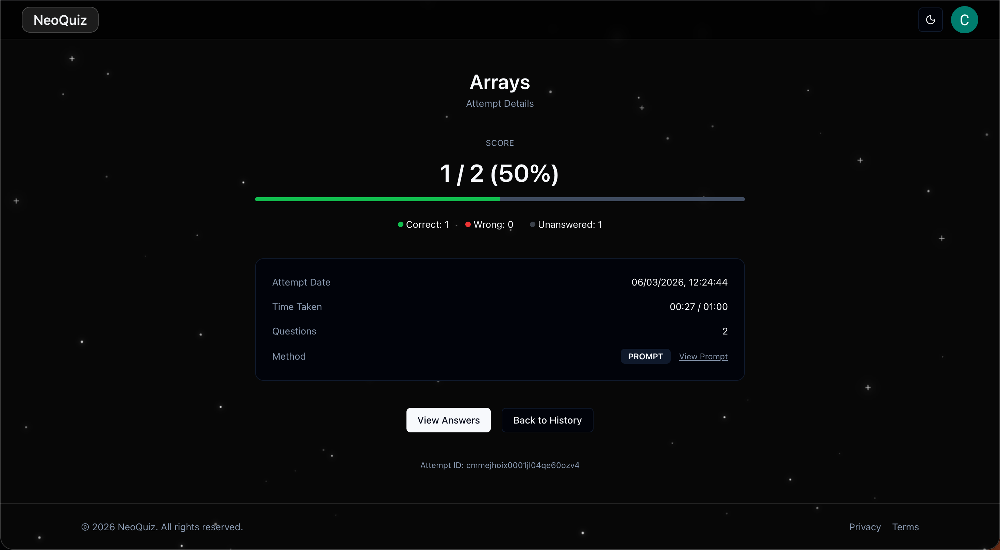
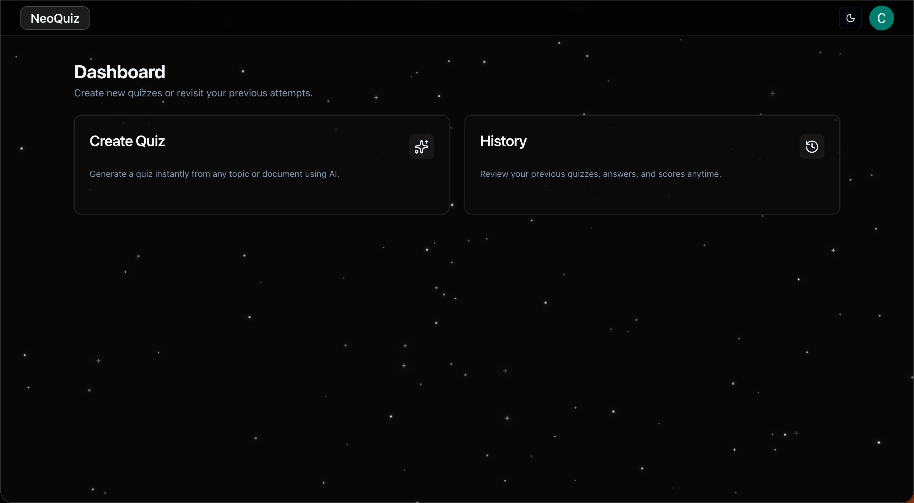

# NeoQuiz


**AI-powered quiz generator** that creates quizzes from prompts or PDF study material using **Google Gemini**.

Generate quizzes instantly, attempt them with an interactive timer, review explanations, and track performance through a persistent quiz history.

---

## Table of Contents

- [Live Demo](#live-demo)
- [Demo](#demo)
- [About The Project](#about-the-project)
- [Screenshots](#screenshots)
- [Features](#features)
- [Tech Stack](#tech-stack)
- [Architecture Overview](#architecture-overview)
- [Project Structure](#project-structure)
- [Getting Started](#getting-started)
- [Future Improvements](#future-improvements)
- [License](#license)
- [Author](#author)


### Live Demo

🔗 https://neoquiz-one.vercel.app

## Demo




## About The Project

NeoQuiz was built as a full-stack project to explore how generative AI can assist learning workflows.

The application allows users to generate quizzes either from a **text prompt** or from **uploaded PDF study material**. The generated quiz can then be attempted interactively, and results are stored so users can review their progress later.

The project focuses on:

- AI-assisted content generation
- Secure authentication
- Persistent quiz history
- Clean UI/UX for quiz attempts
- Safe server-side API design

## Screenshots

### Landing Page



---

### Quiz Generation





---

### Quiz Attempt



---

### Quiz Results



---

### Quiz History





---

### Dashboard




## Features

- Generate quizzes using **AI**
- Create quizzes from text prompts
- Create quizzes from PDF study material
- Automatic quiz title generation
- Interactive quiz attempt interface
- Answer explanations for learning
- Quiz history tracking
- Google authentication
- Persistent storage using PostgreSQL
- Secure API routes
  
## Tech Stack


## Architecture Overview

```
User
  ↓
Next.js Frontend (React UI)
  ↓
API Routes
  ↓
Google Gemini API (Quiz Generation)
  ↓
PostgreSQL Database (Prisma ORM)
```

## Project Structure

```
src/
  app/          → pages and routing
  api/          → backend API routes
  components/   → UI components
  lib/          → authentication, prisma client, helpers

prisma/
  schema.prisma → database models
```

## Getting Started

Clone the repository

```bash
git clone https://github.com/Ashwinr03/neoquiz.git
```

Install dependencies

```bash
npm install
```

Create a `.env.local` file in the root directory and add the following variables:

```env
DATABASE_URL=your_postgresql_connection_string
NEXTAUTH_SECRET=your_nextauth_secret
NEXTAUTH_URL=http://localhost:3000
GOOGLE_CLIENT_ID=your_google_oauth_client_id
GOOGLE_CLIENT_SECRET=your_google_oauth_client_secret
GEMINI_API_KEY=your_gemini_api_key
```

Run the development server

```bash
npm run dev
```

Open in your browser

```
http://localhost:3000
```


## Future Improvements

Potential future improvements include:

- Difficulty levels for quizzes
- Quiz sharing links
- Leaderboard system
- Improved PDF parsing
- Analytics dashboard for quiz performance

---

## License

This project is licensed under the **Unlicense**.

---

## Author

**Ashwin Ramesh**

GitHub: https://github.com/Ashwinr03  
Live Project: https://neoquiz-one.vercel.app

